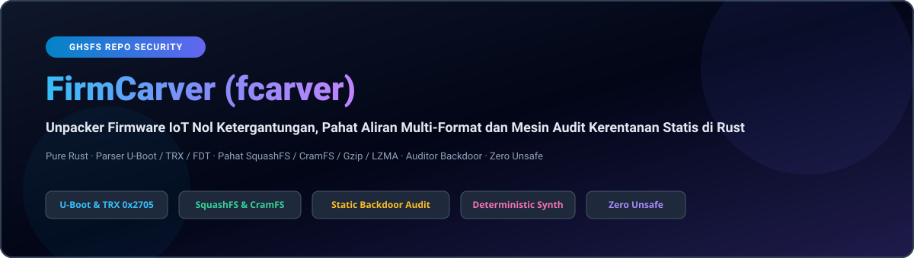
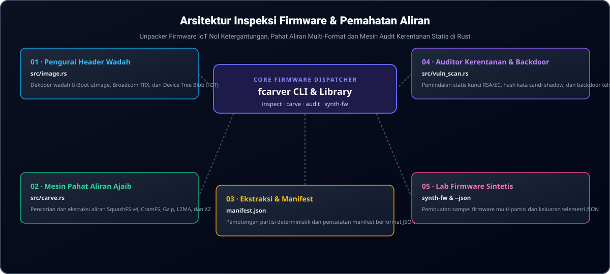

<div align="center">

<p align="center">
  <a href="../../README.md">🇺🇸 English</a> · <a href="./ko.md">🇰🇷 한국어</a> · <a href="./zh-CN.md">🇨🇳 中文</a> · <a href="./es.md">🇪🇸 Español</a> · <a href="./hi.md">🇮🇳 हिन्दी</a><br />
  <a href="./ar.md">🇸🇦 العربية</a> · <a href="./pt-BR.md">🇧🇷 Português</a> · <a href="./ru.md">🇷🇺 Русский</a> · <a href="./fr.md">🇫🇷 Français</a> · <strong>🇮🇩 Bahasa Indonesia</strong>
</p>

<p align="center">
  
</p>

# FirmCarver (fcarver)

**Unpacker Firmware IoT Nol Ketergantungan, Pahat Aliran Multi-Format dan Mesin Audit Kerentanan Statis di Rust**

[](https://github.com/GHSFS/firm-carver/actions/workflows/ci.yml)
[](../../LICENSE)
[](./Cargo.toml)
[](../../SECURITY.md)

<sub>Architected &amp; Licensed by **GHSFS** · Zero-Dependency IoT Firmware Analysis &amp; Carving</sub>

</div>

---

## 🛡️ Ikhtisar & Kemampuan Inti

<details open>
<summary><b>🛡️ Ikhtisar & Kemampuan Inti</b></summary>
<br>

firm-carver (fcarver) adalah utilitas CLI dan pustaka Rust murni untuk inspeksi wadah firmware IoT offline, pemahatan aliran sistem file terkompresi, dan audit keamanan statis tanpa pustaka C eksternal atau dependensi binwalk.

1. **Zero-Dependency Container Header Parsers (`src/image.rs`)** — Automatically detects and verifies U-Boot `uImage` (Magic `0x27051956` big-endian with dual 32-bit CRC calculation), Broadcom `TRX` headers (`0x30304448` / `HDR0` with 3 partition offsets), and Flattened Device Tree blobs (`0xD00DFEED` / FDT).
2. **Magic-Byte Stream Carving Engine (`src/carve.rs`)** — Scans raw firmware blobs for SquashFS 4.0 (`0x73717368` / `0x68737173`), CramFS (`0x28cd3d45` / `0x453dcd28`), Gzip (`0x1F8B08`), LZMA (`0x5D0000`), and XZ (`0xFD377A585A00`), extracts partitions into dedicated files, and writes structured JSON manifests.
3. **Static Firmware Vulnerability & Backdoor Auditor (`src/vuln_scan.rs`)** — Identifies hardcoded private keys (RSA, EC, OpenSSH, PKCS#8), static `/etc/shadow` root hashes, empty root accounts, unauthenticated root shells (`telnetd -l /bin/sh`), firewall flushing (`iptables -F`), and netcat reverse shells.
4. **Deterministic Firmware Synthesis (`fcarver synth-fw`)** — Generates valid synthetic firmware blobs containing headers and filesystem streams for automated CI verification and vulnerability signature validation.
5. **Entropy-Guided Bootloader & Kernel Boundary Slicer (`src/slicer/`)** — Computes sliding-window Shannon entropy profiles, detecting sharp inflection points between bootloaders, compressed kernels, and encrypted filesystems.
6. **Cryptographic Integrity & Attestation Manifest Generator (`src/integrity/`)** — Computes SHA-256, SHA-512, and BLAKE3 digests across images and carved partitions, emitting and verifying tamper-evident integrity manifests.
7. **Embedded Web Management & CGI Static Auditor (`src/cgi_audit/`)** — Audits carved `/www` directory trees and CGI scripts for command injection vulnerabilities (`system()`, `popen()`, unescaped `$QUERY_STRING`), unauthenticated administrative routes, backdoor cookies, hardcoded credentials, and path traversal flaws.
8. **Hardcoded TLS Certificate & Expired Root CA Scanner (`src/cert_audit/`)** — Zero-dependency pure-Rust ASN.1 DER parser and RFC 4648 Base64 PEM decoder for X.509 certificates and PKCS#1/PKCS#8 private keys, checking expiration, weak signatures (MD5/SHA1), weak RSA keys (<2048), self-signed certs, and paired private keys.
9. **JFFS2 Flash Filesystem Carver & Node Reconstructor (`src/jffs2/`)** — Pure-Rust JFFS2 flash filesystem parser and carver for NOR/NAND partitions supporting Little-Endian (`0x85 0x19`) and Big-Endian (`0x19 0x85`), RTIME and Zlib decompression with bounds-checked CVE-2024-57850 hardening, tombstone resolution, and filesystem extraction.
10. **UBI & UBIFS Volume Header Parser & Filesystem Reconstructor (`src/ubifs/`)** — Zero-dependency pure-Rust UBI physical erase block (PEB) parser, VID header decoder, layout volume table reader, and UBIFS superblock, master node, and directory tree extractor for NAND router flash dumps.

</details>

---

## 🏛️ Arsitektur Inspeksi Firmware & Pemahatan Aliran

<details open>
<summary><b>🏛️ Arsitektur Inspeksi Firmware & Pemahatan Aliran</b></summary>
<br>

<p align="center">
  
</p>

| # | Component | Module | Responsibility |
|---|---|---|---|
| **01** | **01 · Pengurai Header Wadah** | `src/image.rs` | Dekoder wadah U-Boot uImage, Broadcom TRX, dan Device Tree Blob (FDT) |
| **02** | **02 · Mesin Pahat Aliran Ajaib** | `src/carve.rs` | Pencarian dan ekstraksi aliran SquashFS v4, CramFS, Gzip, LZMA, dan XZ |
| **03** | **03 · Ekstraksi & Manifest** | `manifest.json` | Pemotongan partisi deterministik dan pencatatan manifest berformat JSON |
| **04** | **04 · Auditor Kerentanan & Backdoor** | `src/vuln_scan.rs` | Pemindaian statis kunci RSA/EC, hash kata sandi shadow, dan backdoor telnetd |
| **05** | **05 · Lab Firmware Sintetis** | `synth-fw & --json` | Pembuatan sampel firmware multi-partisi dan keluaran telemetri JSON |

</details>

---

## 🚀 Panduan Cepat & Penggunaan CLI

<details open>
<summary><b>🚀 Panduan Cepat & Penggunaan CLI</b></summary>
<br>

```bash
# 1. Build the release binary
cargo build --release

# 2. Generate a deterministic sample firmware image (U-Boot or TRX)
./target/release/fcarver synth-fw sample_uboot.bin --type uboot
./target/release/fcarver synth-fw sample_trx.bin --type trx

# 3. Inspect container headers (U-Boot, TRX, FDT)
./target/release/fcarver inspect sample_uboot.bin
./target/release/fcarver inspect sample_uboot.bin --json

# 4. Carve embedded filesystems (SquashFS, CramFS) and compressed streams
./target/release/fcarver carve sample_uboot.bin --out ./extracted_fs
./target/release/fcarver carve sample_uboot.bin --out ./extracted_fs --json

# 5. Extract SquashFS directory tree, file permissions, and symlinks
./target/release/fcarver squashfs sample_uboot.bin --list
./target/release/fcarver squashfs sample_uboot.bin --json

# 6. Disassemble Device Tree Blob (FDT) into DTS or map hardware peripherals
./target/release/fcarver fdt sample_uboot.bin --dts
./target/release/fcarver fdt sample_uboot.bin --hardware
./target/release/fcarver fdt sample_uboot.bin --json

# 7. Detect CPU instruction set and scan for shellcode payloads (MIPS, ARM, AArch64, RISC-V)
./target/release/fcarver arch-detect sample_uboot.bin
./target/release/fcarver arch-detect sample_uboot.bin --json
./target/release/fcarver arch-detect sample_uboot.bin --disasm

# 8. Slice bootloader, kernel, and filesystem partitions via Shannon entropy
./target/release/fcarver slice sample_uboot.bin --plot
./target/release/fcarver slice sample_uboot.bin --json
./target/release/fcarver slice sample_uboot.bin --out ./sliced_fs

# 9. Generate and verify cryptographic digests (SHA-256, SHA-512, BLAKE3) and integrity manifests
./target/release/fcarver integrity sample_uboot.bin
./target/release/fcarver integrity sample_uboot.bin --out manifest.json
./target/release/fcarver integrity sample_uboot.bin --verify manifest.json
./target/release/fcarver integrity sample_uboot.bin --algo blake3
./target/release/fcarver integrity sample_uboot.bin --json

# 10. Audit extracted web management interface and CGI scripts for vulnerabilities
./target/release/fcarver cgi-audit ./extracted_fs/www
./target/release/fcarver cgi-audit ./extracted_fs/www --min-severity high --json
./target/release/fcarver cgi-audit ./extracted_fs/www --out cgi_report.json

# 11. Extract JFFS2 flash filesystem directory tree, file permissions, and symlinks
./target/release/fcarver jffs2 sample_jffs2.bin --list
./target/release/fcarver jffs2 sample_jffs2.bin --extract ./extracted_jffs2
./target/release/fcarver jffs2 sample_jffs2.bin --json

# 12. Parse UBI volumes, layout tables, and extract UBIFS directory trees
./target/release/fcarver ubifs sample_ubi.bin --list
./target/release/fcarver ubifs sample_ubi.bin --extract ./extracted_ubifs
./target/release/fcarver ubifs sample_ubi.bin --json

# 13. Audit hardcoded TLS certificates, expired root CAs, and leaked private keys
./target/release/fcarver cert-audit sample_uboot.bin
./target/release/fcarver cert-audit sample_uboot.bin --min-severity high --json
./target/release/fcarver cert-audit ./extracted_fs/etc/ssl --out cert_report.json

# 14. Extract, carve, and audit Broadcom and MediaTek NVRAM tables and parameters
./target/release/fcarver nvram sample_nvram.bin --list
./target/release/fcarver nvram sample_nvram.bin --audit
./target/release/fcarver nvram sample_nvram.bin --extract ./nvram.env

# 15. Audit embedded network endpoints, cleartext HTTP OTAs, and telemetry domains
./target/release/fcarver domain-audit sample_uboot.bin
./target/release/fcarver domain-audit sample_uboot.bin --min-severity medium --json
./target/release/fcarver domain-audit ./extracted_fs --out domain_report.json

# 16. Audit firmware blob for embedded private keys, default credentials, and backdoors
./target/release/fcarver audit sample_uboot.bin
./target/release/fcarver audit sample_uboot.bin --json
```

</details>

---

## 📦 Referensi Modul & Subperintah

<details open>
<summary><b>📦 Referensi Modul & Subperintah</b></summary>
<br>

| Subcommand | Arguments | Description |
|---|---|---|
| `inspect` | `<file> [--json]` | Identifies container headers: U-Boot, TRX, FDT, architecture, offsets |
| `carve` | `<file> --out <dir> [--json]` | Carves embedded SquashFS, CramFS, JFFS2, UBI, Gzip, LZMA partitions to disk |
| `squashfs` | `<file> [--list] [--json] [--offset <bytes>]` | Extracts directory tree, inode metadata, and symlinks from SquashFS v4 |
| `jffs2` | `<file> [--list] [--extract <dir>] [--json] [--offset <bytes>]` | Extracts directory tree, inode metadata, and symlinks from JFFS2 flash |
| `ubifs` | `<file> [--list] [--extract <dir>] [--peb-size <bytes>] [--json] [--offset <bytes>]` | Parses UBI volume headers, LEB mappings, and extracts UBIFS directory trees |
| `fdt` | `<file> [--dts] [--hardware] [--json] [--offset <bytes>]` | Disassembles Device Tree (FDT) into DTS and maps peripheral hardware |
| `arch-detect` | `<file> [--offset <bytes>] [--length <bytes>] [--min-confidence <float>] [--disasm] [--json]` | Scores CPU architecture (MIPS/ARM/AArch64/RISC-V) and detects shellcode payloads |
| `slice` | `<file> [--window <bytes>] [--step <bytes>] [--threshold <float>] [--plot] [--out <dir>] [--json]` | Computes sliding Shannon entropy, detects bootloader/kernel boundaries, slices partitions |
| `integrity` | `<file> [--out <manifest.json>] [--verify <manifest.json>] [--algo <sha256|sha512|blake3|all>] [--json]` | Generates and verifies SHA-256, SHA-512, BLAKE3 digests and partition attestation manifests |
| `cgi-audit` | `<target> [--out <file.json>] [--min-severity <level>] [--json]` | Audits web files and CGI scripts for command injection, auth bypass, and backdoors |
| `cert-audit` | `<target> [--min-severity <level>] [--reference-date <date>] [--out <file.json>] [--json]` | Audits X.509 certificates and private keys for expiry, weak crypto, and leaks |
| `nvram` | `<file> [--list] [--audit] [--extract <file.env>] [--format <auto|bcm|mtk>] [--json]` | Extracts, carves, and audits Broadcom and MediaTek NVRAM configuration tables |
| `domain-audit` | `<target> [--min-severity <level>] [--filter <kind>] [--no-private] [--out <file.json>] [--json]` | Extracts and audits URLs, IPv4/IPv6 endpoints, and telemetry domains |
| `audit` | `<file> [--json]` | Scans for hardcoded credentials, private keys, backdoor commands |
| `synth-fw` | `<output> [--type <uboot|trx|fdt|squashfs|jffs2|jffs2-be|ubi|ubi-be|ubifs|ubifs-be|cert-store|cert-blob|nvram-bcm|nvram-mtk|nvram-dat|domain-vuln|domain-hardened|multi-stage|shellcode-mips|shellcode-arm|shellcode-aarch64|shellcode-riscv|integrity|cgi-tree|vuln-cgi>]` | Generates a valid synthetic firmware blob or web tree for testing |

</details>

---

## 🔒 Keamanan Memori & Pengerasan Parser

<details open>
<summary><b>🔒 Keamanan Memori & Pengerasan Parser</b></summary>
<br>

- **100% Safe Rust**: No `unsafe` blocks are permitted in parser or carver code paths.
- **Slice Bounds & Integer Overflow Hardening**: All partition offsets and length calculations are guarded against integer wrapping and buffer over-reads.
- **Buffer Sanitization**: Sensitive decrypted or analyzed data buffers implement explicit zeroization on drop via `zeroize`.

See [SECURITY.md](../../SECURITY.md) for our vulnerability disclosure policy and parser invariants.

</details>

---

## 📄 Lisensi & Atribusi

<details open>
<summary><b>📄 Lisensi & Atribusi</b></summary>
<br>

Licensed under the **Apache License, Version 2.0**. See [LICENSE](../../LICENSE) and [NOTICE](./NOTICE) for copyright and attribution details.

Check our long-term milestones in [ROADMAP.md](../../ROADMAP.md).

</details>
