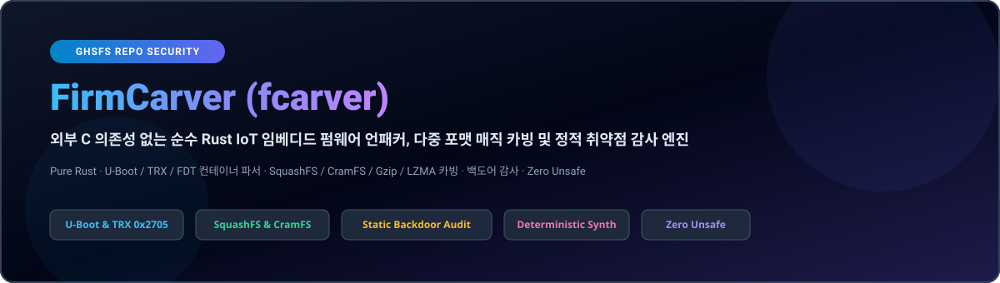
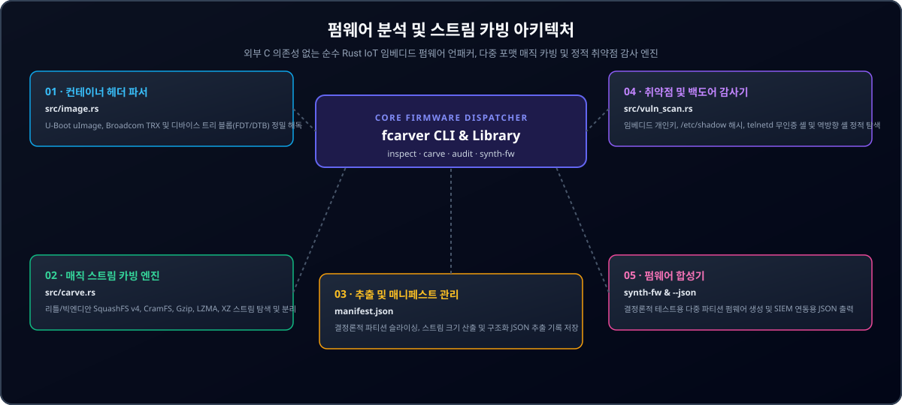

<div align="center">

<p align="center">
  <a href="../../README.md">🇺🇸 English</a> · <strong>🇰🇷 한국어</strong> · <a href="./zh-CN.md">🇨🇳 中文</a> · <a href="./es.md">🇪🇸 Español</a> · <a href="./hi.md">🇮🇳 हिन्दी</a><br />
  <a href="./ar.md">🇸🇦 العربية</a> · <a href="./pt-BR.md">🇧🇷 Português</a> · <a href="./ru.md">🇷🇺 Русский</a> · <a href="./fr.md">🇫🇷 Français</a> · <a href="./id.md">🇮🇩 Bahasa Indonesia</a>
</p>

<p align="center">
  
</p>

# FirmCarver (fcarver)

**외부 C 의존성 없는 순수 Rust IoT 임베디드 펌웨어 언패커, 다중 포맷 매직 카빙 및 정적 취약점 감사 엔진**

[](https://github.com/GHSFS/firm-carver/actions/workflows/ci.yml)
[](../../LICENSE)
[](./Cargo.toml)
[](../../SECURITY.md)

<sub>Architected &amp; Licensed by **GHSFS** · Zero-Dependency IoT Firmware Analysis &amp; Carving</sub>

</div>

---

## 🛡️ 개요 및 핵심 기능

<details open>
<summary><b>🛡️ 개요 및 핵심 기능</b></summary>
<br>

firm-carver (fcarver)는 외부 C 라이브러리나 binwalk 등의 도구 없이 순수 Rust로 구현된 초고속 임베디드 IoT 펌웨어 컨테이너 분석, 다중 포맷 파일시스템 스트림 카빙 및 정적 보안 감사 CLI 도구이자 라이브러리입니다.

1. **Zero-Dependency Container Header Parsers (`src/image.rs`)** — Automatically detects and verifies U-Boot `uImage` (Magic `0x27051956` big-endian with dual 32-bit CRC calculation), Broadcom `TRX` headers (`0x30304448` / `HDR0` with 3 partition offsets), and Flattened Device Tree blobs (`0xD00DFEED` / FDT).
2. **Magic-Byte Stream Carving Engine (`src/carve.rs`)** — Scans raw firmware blobs for SquashFS 4.0 (`0x73717368` / `0x68737173`), CramFS (`0x28cd3d45` / `0x453dcd28`), Gzip (`0x1F8B08`), LZMA (`0x5D0000`), and XZ (`0xFD377A585A00`), extracts partitions into dedicated files, and writes structured JSON manifests.
3. **Static Firmware Vulnerability & Backdoor Auditor (`src/vuln_scan.rs`)** — Identifies hardcoded private keys (RSA, EC, OpenSSH, PKCS#8), static `/etc/shadow` root hashes, empty root accounts, unauthenticated root shells (`telnetd -l /bin/sh`), firewall flushing (`iptables -F`), and netcat reverse shells.
4. **Deterministic Firmware Synthesis (`fcarver synth-fw`)** — Generates valid synthetic firmware blobs containing headers and filesystem streams for automated CI verification and vulnerability signature validation.

</details>

---

## 🏛️ 펌웨어 분석 및 스트림 카빙 아키텍처

<details open>
<summary><b>🏛️ 펌웨어 분석 및 스트림 카빙 아키텍처</b></summary>
<br>

<p align="center">
  
</p>

| # | Component | Module | Responsibility |
|---|---|---|---|
| **01** | **01 · 컨테이너 헤더 파서** | `src/image.rs` | U-Boot uImage, Broadcom TRX 및 디바이스 트리 블롭(FDT/DTB) 정밀 해독 |
| **02** | **02 · 매직 스트림 카빙 엔진** | `src/carve.rs` | 리틀/빅엔디안 SquashFS v4, CramFS, Gzip, LZMA, XZ 스트림 탐색 및 분리 |
| **03** | **03 · 추출 및 매니페스트 관리** | `manifest.json` | 결정론적 파티션 슬라이싱, 스트림 크기 산출 및 구조화 JSON 추출 기록 저장 |
| **04** | **04 · 취약점 및 백도어 감사기** | `src/vuln_scan.rs` | 임베디드 개인키, /etc/shadow 해시, telnetd 무인증 셸 및 역방향 셸 정적 탐색 |
| **05** | **05 · 펌웨어 합성기** | `synth-fw & --json` | 결정론적 테스트용 다중 파티션 펌웨어 생성 및 SIEM 연동용 JSON 출력 |

</details>

---

## 🚀 빠른 시작 및 CLI 사용법

<details open>
<summary><b>🚀 빠른 시작 및 CLI 사용법</b></summary>
<br>

```bash
# 1. Build the release binary
cargo build --release

# 2. Generate a deterministic sample firmware image (U-Boot or TRX)
./target/release/fcarver synth-fw sample_uboot.bin --type uboot
./target/release/fcarver synth-fw sample_trx.bin --type trx

# 3. Inspect container headers (U-Boot, TRX, FDT)
./target/release/fcarver inspect sample_uboot.bin
./target/release/fcarver inspect sample_uboot.bin --json

# 4. Carve embedded filesystems (SquashFS, CramFS) and compressed streams
./target/release/fcarver carve sample_uboot.bin --out ./extracted_fs
./target/release/fcarver carve sample_uboot.bin --out ./extracted_fs --json

# 5. Extract SquashFS directory tree, file permissions, and symlinks
./target/release/fcarver squashfs sample_uboot.bin --list
./target/release/fcarver squashfs sample_uboot.bin --json

# 6. Audit firmware blob for embedded private keys, default credentials, and backdoors
./target/release/fcarver audit sample_uboot.bin
./target/release/fcarver audit sample_uboot.bin --json
```

</details>

---

## 📦 모듈 및 서브커맨드 명세

<details open>
<summary><b>📦 모듈 및 서브커맨드 명세</b></summary>
<br>

| Subcommand | Arguments | Description |
|---|---|---|
| `inspect` | `<file> [--json]` | Identifies container headers: U-Boot, TRX, FDT, architecture, offsets |
| `carve` | `<file> --out <dir> [--json]` | Carves embedded SquashFS, CramFS, Gzip, LZMA partitions to disk |
| `squashfs` | `<file> [--list] [--json] [--offset <bytes>]` | Extracts directory tree, inode metadata, and symlinks from SquashFS v4 |
| `audit` | `<file> [--json]` | Scans for hardcoded credentials, private keys, backdoor commands |
| `synth-fw` | `<output> [--type <uboot|trx|squashfs>]` | Generates a valid synthetic firmware blob for testing/analysis |


</details>

---

## 🔒 메모리 안전성 및 파서 보안 설계

<details open>
<summary><b>🔒 메모리 안전성 및 파서 보안 설계</b></summary>
<br>

- **100% Safe Rust**: No `unsafe` blocks are permitted in parser or carver code paths.
- **Slice Bounds & Integer Overflow Hardening**: All partition offsets and length calculations are guarded against integer wrapping and buffer over-reads.
- **Buffer Sanitization**: Sensitive decrypted or analyzed data buffers implement explicit zeroization on drop via `zeroize`.

See [SECURITY.md](../../SECURITY.md) for our vulnerability disclosure policy and parser invariants.

</details>

---

## 📄 라이선스 및 저작권 안내

<details open>
<summary><b>📄 라이선스 및 저작권 안내</b></summary>
<br>

Licensed under the **Apache License, Version 2.0**. See [LICENSE](../../LICENSE) and [NOTICE](./NOTICE) for copyright and attribution details.

Check our long-term milestones in [ROADMAP.md](../../ROADMAP.md).

</details>
