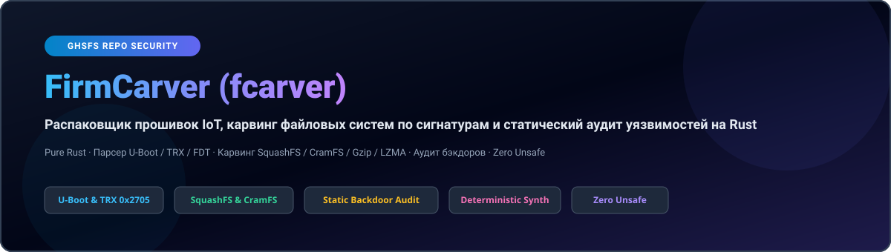
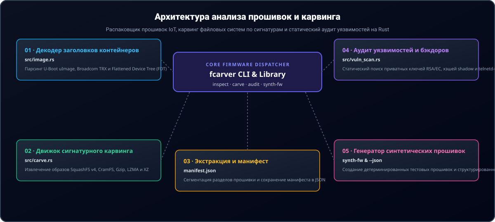

<div align="center">

<p align="center">
  <a href="../../README.md">🇺🇸 English</a> · <a href="./ko.md">🇰🇷 한국어</a> · <a href="./zh-CN.md">🇨🇳 中文</a> · <a href="./es.md">🇪🇸 Español</a> · <a href="./hi.md">🇮🇳 हिन्दी</a><br />
  <a href="./ar.md">🇸🇦 العربية</a> · <a href="./pt-BR.md">🇧🇷 Português</a> · <strong>🇷🇺 Русский</strong> · <a href="./fr.md">🇫🇷 Français</a> · <a href="./id.md">🇮🇩 Bahasa Indonesia</a>
</p>

<p align="center">
  
</p>

# FirmCarver (fcarver)

**Распаковщик прошивок IoT, карвинг файловых систем по сигнатурам и статический аудит уязвимостей на Rust**

[](https://github.com/GHSFS/firm-carver/actions/workflows/ci.yml)
[](../../LICENSE)
[](./Cargo.toml)
[](../../SECURITY.md)

<sub>Architected &amp; Licensed by **GHSFS** · Zero-Dependency IoT Firmware Analysis &amp; Carving</sub>

</div>

---

## 🛡️ Обзор и ключевые возможности

<details open>
<summary><b>🛡️ Обзор и ключевые возможности</b></summary>
<br>

firm-carver (fcarver) — это консольная утилита и библиотека на чистом Rust для автономного анализа контейнеров прошивок IoT, карвинга сжатых файловых систем и статического аудита безопасности без внешних C-библиотек и binwalk.

1. **Zero-Dependency Container Header Parsers (`src/image.rs`)** — Automatically detects and verifies U-Boot `uImage` (Magic `0x27051956` big-endian with dual 32-bit CRC calculation), Broadcom `TRX` headers (`0x30304448` / `HDR0` with 3 partition offsets), and Flattened Device Tree blobs (`0xD00DFEED` / FDT).
2. **Magic-Byte Stream Carving Engine (`src/carve.rs`)** — Scans raw firmware blobs for SquashFS 4.0 (`0x73717368` / `0x68737173`), CramFS (`0x28cd3d45` / `0x453dcd28`), Gzip (`0x1F8B08`), LZMA (`0x5D0000`), and XZ (`0xFD377A585A00`), extracts partitions into dedicated files, and writes structured JSON manifests.
3. **Static Firmware Vulnerability & Backdoor Auditor (`src/vuln_scan.rs`)** — Identifies hardcoded private keys (RSA, EC, OpenSSH, PKCS#8), static `/etc/shadow` root hashes, empty root accounts, unauthenticated root shells (`telnetd -l /bin/sh`), firewall flushing (`iptables -F`), and netcat reverse shells.
4. **Deterministic Firmware Synthesis (`fcarver synth-fw`)** — Generates valid synthetic firmware blobs containing headers and filesystem streams for automated CI verification and vulnerability signature validation.
5. **Entropy-Guided Bootloader & Kernel Boundary Slicer (`src/slicer/`)** — Computes sliding-window Shannon entropy profiles, detecting sharp inflection points between bootloaders, compressed kernels, and encrypted filesystems.

</details>

---

## 🏛️ Архитектура анализа прошивок и карвинга

<details open>
<summary><b>🏛️ Архитектура анализа прошивок и карвинга</b></summary>
<br>

<p align="center">
  
</p>

| # | Component | Module | Responsibility |
|---|---|---|---|
| **01** | **01 · Декодер заголовков контейнеров** | `src/image.rs` | Парсинг U-Boot uImage, Broadcom TRX и Flattened Device Tree (FDT) |
| **02** | **02 · Движок сигнатурного карвинга** | `src/carve.rs` | Извлечение образов SquashFS v4, CramFS, Gzip, LZMA и XZ |
| **03** | **03 · Экстракция и манифест** | `manifest.json` | Сегментация разделов прошивки и сохранение манифеста в JSON |
| **04** | **04 · Аудит уязвимостей и бэкдоров** | `src/vuln_scan.rs` | Статический поиск приватных ключей RSA/EC, хэшей shadow и telnetd-бэкдоров |
| **05** | **05 · Генератор синтетических прошивок** | `synth-fw & --json` | Создание детерминированных тестовых прошивок и структурированный JSON |

</details>

---

## 🚀 Быстрый старт и использование CLI

<details open>
<summary><b>🚀 Быстрый старт и использование CLI</b></summary>
<br>

```bash
# 1. Build the release binary
cargo build --release

# 2. Generate a deterministic sample firmware image (U-Boot or TRX)
./target/release/fcarver synth-fw sample_uboot.bin --type uboot
./target/release/fcarver synth-fw sample_trx.bin --type trx

# 3. Inspect container headers (U-Boot, TRX, FDT)
./target/release/fcarver inspect sample_uboot.bin
./target/release/fcarver inspect sample_uboot.bin --json

# 4. Carve embedded filesystems (SquashFS, CramFS) and compressed streams
./target/release/fcarver carve sample_uboot.bin --out ./extracted_fs
./target/release/fcarver carve sample_uboot.bin --out ./extracted_fs --json

# 5. Extract SquashFS directory tree, file permissions, and symlinks
./target/release/fcarver squashfs sample_uboot.bin --list
./target/release/fcarver squashfs sample_uboot.bin --json

# 6. Disassemble Device Tree Blob (FDT) into DTS or map hardware peripherals
./target/release/fcarver fdt sample_uboot.bin --dts
./target/release/fcarver fdt sample_uboot.bin --hardware
./target/release/fcarver fdt sample_uboot.bin --json

# 7. Detect CPU instruction set and scan for shellcode payloads (MIPS, ARM, AArch64, RISC-V)
./target/release/fcarver arch-detect sample_uboot.bin
./target/release/fcarver arch-detect sample_uboot.bin --json
./target/release/fcarver arch-detect sample_uboot.bin --disasm

# 8. Slice bootloader, kernel, and filesystem partitions via Shannon entropy
./target/release/fcarver slice sample_uboot.bin --plot
./target/release/fcarver slice sample_uboot.bin --json
./target/release/fcarver slice sample_uboot.bin --out ./sliced_fs

# 9. Audit firmware blob for embedded private keys, default credentials, and backdoors
./target/release/fcarver audit sample_uboot.bin
./target/release/fcarver audit sample_uboot.bin --json
```

</details>

---

## 📦 Справочник модулей и подкоманд

<details open>
<summary><b>📦 Справочник модулей и подкоманд</b></summary>
<br>

| Subcommand | Arguments | Description |
|---|---|---|
| `inspect` | `<file> [--json]` | Identifies container headers: U-Boot, TRX, FDT, architecture, offsets |
| `carve` | `<file> --out <dir> [--json]` | Carves embedded SquashFS, CramFS, Gzip, LZMA partitions to disk |
| `squashfs` | `<file> [--list] [--json] [--offset <bytes>]` | Extracts directory tree, inode metadata, and symlinks from SquashFS v4 |
| `fdt` | `<file> [--dts] [--hardware] [--json] [--offset <bytes>]` | Disassembles Device Tree (FDT) into DTS and maps peripheral hardware |
| `arch-detect` | `<file> [--offset <bytes>] [--length <bytes>] [--min-confidence <float>] [--disasm] [--json]` | Scores CPU architecture (MIPS/ARM/AArch64/RISC-V) and detects shellcode payloads |
| `slice` | `<file> [--window <bytes>] [--step <bytes>] [--threshold <float>] [--plot] [--out <dir>] [--json]` | Computes sliding Shannon entropy, detects bootloader/kernel boundaries, slices partitions |
| `audit` | `<file> [--json]` | Scans for hardcoded credentials, private keys, backdoor commands |
| `synth-fw` | `<output> [--type <uboot|trx|fdt|squashfs|multi-stage|shellcode-mips|shellcode-arm|shellcode-aarch64|shellcode-riscv>]` | Generates a valid synthetic firmware blob for testing/analysis |


</details>

---

## 🔒 Безопасность памяти и защита парсера

<details open>
<summary><b>🔒 Безопасность памяти и защита парсера</b></summary>
<br>

- **100% Safe Rust**: No `unsafe` blocks are permitted in parser or carver code paths.
- **Slice Bounds & Integer Overflow Hardening**: All partition offsets and length calculations are guarded against integer wrapping and buffer over-reads.
- **Buffer Sanitization**: Sensitive decrypted or analyzed data buffers implement explicit zeroization on drop via `zeroize`.

See [SECURITY.md](../../SECURITY.md) for our vulnerability disclosure policy and parser invariants.

</details>

---

## 📄 Лицензия и авторские права

<details open>
<summary><b>📄 Лицензия и авторские права</b></summary>
<br>

Licensed under the **Apache License, Version 2.0**. See [LICENSE](../../LICENSE) and [NOTICE](./NOTICE) for copyright and attribution details.

Check our long-term milestones in [ROADMAP.md](../../ROADMAP.md).

</details>
